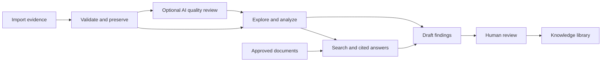

# Workspace workflow

The workspace turns recorded evidence into an investigation, cited guidance and a human-reviewed knowledge record. All of it runs locally with the installed configuration.

## 1. Configure the AI

Open **AI settings** from the sidebar.

- **Main AI** selects the model for answers and draft findings. Apply model downloads missing supported weights, tests compatibility and switches only after success.
- **Quality agent** selects a separate model for read-only data review. Enable or pause it independently. Review options control automatic incoming-data reviews and the maximum number of model passes.
- **Library** adds a model by Ollama name/tag or official library link. Choose Main AI, Quality agent or Download only. Removing a model requires a preview and confirmation; assigned models are protected.
- **Advanced** contains server connections, saved profiles, hardware matching and resource details. Hardware matching can adapt the main model after a hardware upgrade.

Document embeddings are separate from these generation models. Switching the main AI does not rebuild the document index. Local Ollama and LM Studio endpoints are supported; LM Studio manages its own downloads.

The sidebar **Live resources** switch shows or hides the CPU/RAM/GPU strip. Its preference survives navigation and application restarts. Hiding the strip removes its browser polling; background model jobs continue normally.

## 2. Add evidence

Use **Add data** to import CSV/TSV, event JSON, or supported text/PDF evidence; bulk import accepts a ZIP collection. Generated examples are also available.

For tabular data, map the time column, measurements, units, states and notes. Review the preview and validation issues before saving. Missing measured timestamps are identified as record order rather than elapsed time. Supported physical units are normalized, while source bytes, checksums and provenance remain preserved.

Optional deterministic repairs are explicit choices applied to a derived import copy. Saving stores the validated event and its original evidence. Enabling automatic quality review queues an independent AI job after storage succeeds.

## 3. Explore and check quality

Open **Explore an event** and choose a dataset.

- **Your data** opens the chart first. Select channels; use **View** for the time window, normalization and display labels. Zoom, pan, reset or export the chart. States and notes remain separate evidence views when present.
- **AI quality review** shows model findings, coverage, cited samples and review actions. Purple graph marks represent tentative AI flags.
- **Data checks** contains deterministic format, timing, units, gaps and declared-expectation checks.
- **Files & exports** contains original/standardized downloads and event attachments.

The quality agent uses bounded descriptive summaries and requested sample windows, with optional comparisons against listed recent datasets. It does not use RAG or arbitrary SQL. Python validates its cited sample coordinates and values. A partial review can miss problems, and unusual physical behavior can be mistaken for corruption.

Accepting or dismissing a quality flag records a review. A repair additionally requires a named reviewer, acceptance of the flag and explicit authorization of the exact proposal. Python revalidates the result and creates a separate corrected event; the original remains intact. Model calls, findings, reviews and copy receipts are recorded in the audit trail.

## 4. Analyze the event

Open **What changed** and run analysis. Python derives numerical features, timelines and plots using the applicable domain processor: RF/SRF, mechanical, PLC or generic descriptive analysis. This is separate from the quality agent and can run with that agent disabled.

Analysis identifies observations and candidate patterns. It does not establish a physical cause or authorize an operational action.

## 5. Add references and ask questions

Use **Documents** to upload reference PDFs, text or Markdown with title/version information. Only documents marked approved enter procedure retrieval.

Use **Related guidance** in the event investigation for a question with the selected event as context, or **Ask a question** for document search. The system retrieves approved passages and supplies them to the main AI. Answers include source references that can be opened and checked. An empty or insufficient procedure library cannot support a document-grounded answer.

## 6. Review and retain knowledge

After analysis, use **Review & save** or **Review & approve** to generate a draft. Read its observations, tentative hypotheses, proposed actions and cited sources. A named reviewer explicitly chooses:

- **Approve:** publish the reviewed result.
- **Correct:** edit and publish the corrected result.
- **Escalate:** record the escalation without publishing it as approved knowledge.

Published results appear in **Knowledge library**, with links to evidence and sources. **Connections** visualizes saved relationships. These links do not establish causation.

## 7. Continue and maintain

Saved events, source files, analyses, reports and review records survive application restarts. Model choices also persist. New models can replace either generation role through AI settings, and unused weights can be removed separately from evidence.

The current deployment is a local, single-user decision-support prototype. Reviewer names are self-declared; there are no authenticated operator roles or accelerator-control actions. Domain validation and the unrelated issues in the workspace audit remain separate from this interface update.
